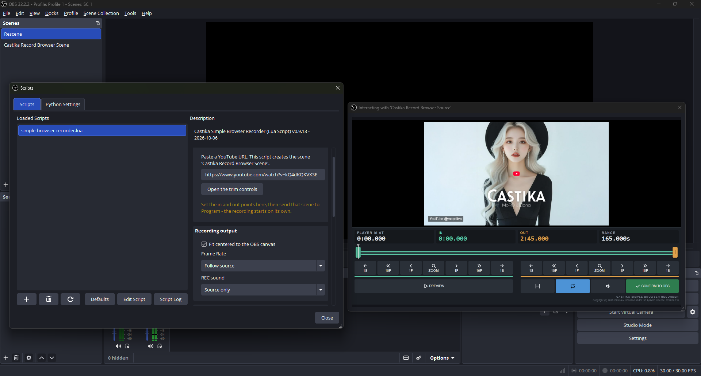
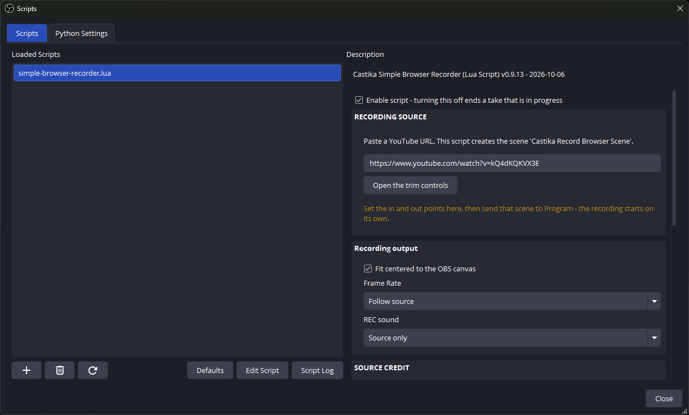
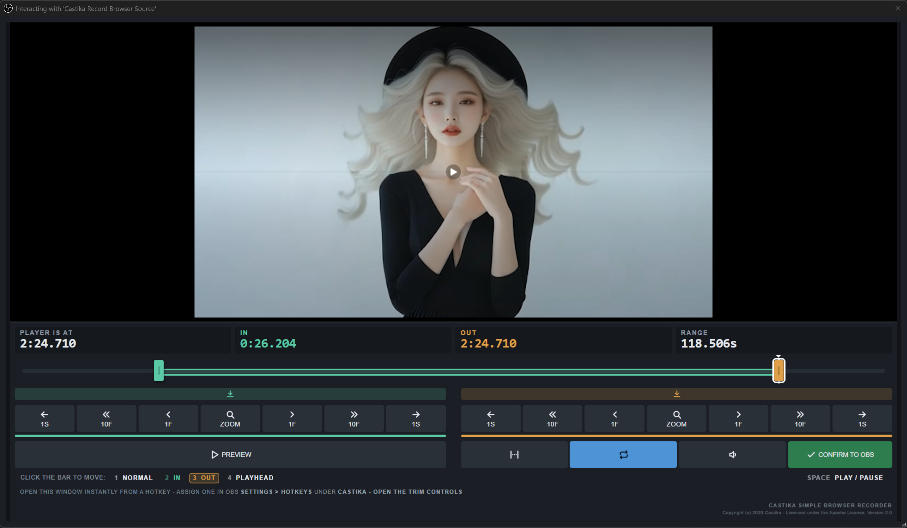

# Castika Simple Browser Source Recorder

An OBS script for news and commentary creators who need to quote video.

## What this is for

You are making news or commentary, and you need to quote a clip from **someone else's**
channel. Not your own footage. Not your own broadcast. A piece of a video you are reacting
to, before or during your stream.

The usual way is: download it, open an editor, cut the part you want, convert it, import it.
This script removes all of that.

Paste the URL. Watch it. Mark the in and out points. OBS writes exactly that range -
trimmed, sized, and credited, with none of the player's controls or chrome in the picture.
No download step, no second editor, no external tools.

## How it records

The script does not press OBS's Record button.

It records on its own instead. It uses a hidden view - a second, invisible render of just
the video - and its own encoder and output. The encoder, the container and the output
folder are copied from your OBS recording settings, so the clip matches everything else you
produce.

Three things follow.

- **It never touches OBS's own recording or stream.** The script writes a separate file
  through its own output.
- **The scene has to be on Program for the take.** That is what starts it and stops it.
  This is not a silent background capture. The quote goes out on Program while it is being
  cut, so your viewers see it if you are live. When the take ends, the script puts Program
  back on the previous scene.
- **Program and the file are not the same picture.** While a take runs, Program shows the
  `REC` banner over the video. The file does not. The script captures the browser source on
  its own, so the banner, the trim controls and the rest of your scene never reach it. The
  credit does - the page draws that into the video itself.

**Fit centered to the OBS canvas** makes the file your canvas size - 1920x1080, or whatever
your scene is - with the video centered inside it. Turn it on and the clip is finished the
moment recording stops. Nothing to resize, nothing to cut, nothing to convert.

## Requirements

OBS Studio. Nothing else to install.
> Tested : Windows 11. OBS 32.2.2 (64bit), Mac 27.0.1. OBS 32.3.2 (Apple Silicon)

## Network

|  |  |
|---|---|
| YouTube | The video itself, in a browser source. |
| `api.github.com` | Version check only: once a day, and when the script's version changes. No video, key or account is sent. Turn it off in the settings and no request is made. |

The script also runs a small HTTP server on your own machine to feed the page to the
browser source. It binds to `127.0.0.1` and `::1` on a random port, is not reachable from
outside, and exits within 20 seconds of OBS closing. Windows uses PowerShell, macOS uses the
system Perl - both ship with the OS. A firewall may ask about it once.

Working folder: `%TEMP%\obs-yt-embed-recorder` (Windows), `$TMPDIR/obs-yt-embed-recorder` (macOS).

## Install

OBS -> Tools -> Scripts -> **+** -> choose `simple-browser-recorder.lua`.

The script creates the scene `Castika Record Browser Scene` the first time it loads.
It also adds `Castika Record Browser Source` and `Castika REC Indicator` to that scene.
Leave all three in place.

## Use

1. Paste a YouTube URL into the script panel.
2. Press **Open the trim controls**, set the in and out points, press **CONFIRM TO OBS**.
3. Send `Castika Record Browser Scene` to Program. Recording starts on its own and stops at the out-point.

While a take is running a `REC` banner sits in the top left of Program. It is a status
display only and is never part of the file.

A `&t=` in the URL becomes the default in-point.

The trim controls also open from a hotkey: OBS -> Settings -> Hotkeys ->
**Castika - open the trim controls**. They refuse to open while the scene is on Program -
switch Program away and ask again.

In the trim controls:

|  |  |
|---|---|
| `1` | Normal |
| `2` | Click the bar to set the in point |
| `3` | Click the bar to set the out point |
| `4` | Click the bar to drag the playhead |
| `SPACE` | Play / pause |

When a take ends the script returns Program to the scene it was on before. In Studio Mode
that is a real transition, so your configured fade will play.

## Settings

|  |  |
|---|---|
| **Enable** | Turns the script off without removing it. |
| **Fit centered to the OBS canvas** | On: the file is your canvas size with the video centered inside it. Off: the file is the video's own size. Nothing is ever cropped. |
| **Resolution** | Shown when *Fit centered* is off: the video's own size, or a height you set. |
| **Frame Rate** | The frame rate of the file. `Follow source` uses OBS's own setting. |
| **REC sound** | `Source only` mutes every other audio source for the length of a take, so a mic or a desktop notification cannot land in the clip, and unmutes them when it ends. `Follow OBS audio mixer setting` records the mix as it stands. |
| **Source credit** | Puts the source in the picture, so a quote carries its attribution wherever it ends up. Choose `YouTube @handle`, `YouTube channel name`, the handle or channel name alone, or your own text. Font, colors, corner, and height are yours to set, and what you see in the preview is what lands in the file. Off by default; turn it on to open the details. |
| **Max recording time** | A cap that stops a runaway take. |
| **Check for updates** | On by default. See [Network](#network). |

## Known Limitations

This script works within YouTube's front-end constraints. The player draws two things over the video that no script can strip:

### Player Control Overlay (at playback start)

YouTube draws its own center playback controls over the first few seconds.

- **Workaround:** Set your in-point at **5 seconds or later**. The script loads the page 5 seconds before that mark and plays up to it behind a black mask, so the overlay is gone before capture begins. Starting at `00:00` captures the overlay.

### End Screens & Outro Cards

In the closing seconds the player draws channel subscribe buttons and recommended cards over the video.

- **Workaround:** Set your out-point before the end screen appears.

## License

Apache License 2.0. See [LICENSE](LICENSE) and [NOTICE](NOTICE).
